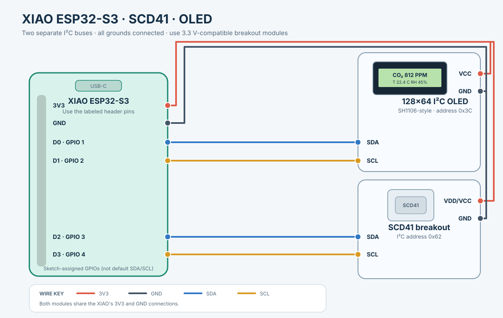

# XIAO ESP32-S3 SCD41 CO₂ display

An Arduino sketch that reads CO₂, temperature, and relative humidity from a Sensirion SCD41 sensor and shows the latest values on a 128×64 I²C OLED. It is wired for a Seeed Studio XIAO ESP32-S3.

## Hardware

- Seeed Studio XIAO ESP32-S3
- Sensirion SCD41 on a breakout board
- 128×64 I²C OLED module, SH1106-style, at address `0x3C`
- Jumper wires

The display and sensor use separate ESP32 I²C controllers. The sketch assigns the OLED to GPIO 1/2 and the SCD41 to GPIO 3/4. On the XIAO these are header pins D0–D3; they are not the board's default I²C pins.

## Wiring

| XIAO ESP32-S3 | Connect to | Purpose |
| --- | --- | --- |
| 3V3 | OLED VCC and SCD41 breakout VDD/VCC | 3.3 V supply |
| GND | OLED GND and SCD41 breakout GND | Common ground |
| D0 (GPIO 1) | OLED SDA | OLED data |
| D1 (GPIO 2) | OLED SCL | OLED clock |
| D2 (GPIO 3) | SCD41 SDA | Sensor data |
| D3 (GPIO 4) | SCD41 SCL | Sensor clock |

Use breakout modules that support 3.3 V power and logic. Check the labels on your modules before wiring; pin names and connector order vary. The GPIO assignments above match the sketch. Seeed's [XIAO ESP32-S3 pin map](https://wiki.seeedstudio.com/xiao_esp32s3_getting_started/) lists the header-to-GPIO mapping.

## Build and upload

1. Install the Arduino IDE and the Espressif ESP32 board package.
2. Open `xiao_scd41_display_test.ino`.
3. Select **XIAO_ESP32S3** (or the matching XIAO ESP32-S3 entry in your installed ESP32 core) and the connected port.
4. Upload the sketch.
5. Open Serial Monitor at **115200 baud** for startup checks and measurement status.

The sketch uses the Arduino core's `Wire` library; no additional Arduino libraries are required.

## What it does

- Initializes the OLED at `0x3C` on GPIO 1/2 and the sensor at `0x62` on GPIO 3/4, both at 100 kHz.
- Checks the SCD4x variant and reports whether it identifies as an SCD41.
- Starts periodic measurement, checks data readiness, and reads CO₂ in ppm, temperature in °C, and relative humidity.
- Checks Sensirion CRC bytes for sensor responses and reports I²C or CRC failures in Serial Monitor.
- Refreshes the screen when a new sensor reading is available (nominally about every 5 seconds).

The OLED shows CO₂ prominently, with temperature and relative humidity below. If the display or sensor is not found, check its power, common ground, I²C wiring, address, and the GPIO assignments above. The sensor needs about one second after power-up before the sketch sends commands.

## Repository contents

- `xiao_scd41_display_test.ino` — Arduino firmware
- `wiring.svg` — wiring diagram
